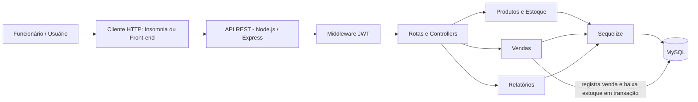

# Moda Store API

API REST para uma loja de roupas, construída com Node.js, Express, Sequelize, MySQL e JWT. Permite autenticar funcionários, cadastrar produtos/variações, acompanhar estoque, registrar vendas e consultar indicadores.

## Requisitos
- Node.js 18 ou superior
- MySQL 8 ou compatível

## Configuração
1. Crie um banco MySQL: `CREATE DATABASE roupas_db CHARACTER SET utf8mb4 COLLATE utf8mb4_unicode_ci;`
2. Copie `.env.example` para `.env` e configure usuário, senha e uma `JWT_SECRET` aleatória com pelo menos 32 caracteres.
3. Instale dependências: `npm install`
4. Inicie: `npm run dev` (desenvolvimento) ou `npm start`.

Na inicialização, Sequelize cria as tabelas necessárias. Para produção, use migrations e não dependa de `sync()` para alterar o esquema.

## Autenticação
Crie o primeiro usuário com `POST /api/auth/register` e entre com `POST /api/auth/login`. Envie o token recebido nas demais rotas como `Authorization: Bearer SEU_TOKEN`.

### Endpoints
| Método | Rota | Descrição |
|---|---|---|
| GET | `/health` | Verificar se a API está ativa |
| POST | `/api/auth/register` | Cadastrar usuário/funcionário |
| POST | `/api/auth/login` | Login e geração de JWT |
| GET | `/api/products` | Listar produtos; filtros `search`, `category`, `active`, `lowStock=true`, `threshold` |
| POST | `/api/products` | Cadastrar produto |
| GET | `/api/products/:id` | Consultar produto |
| PUT | `/api/products/:id` | Atualizar produto ou estoque |
| DELETE | `/api/products/:id` | Desativar produto (não apaga histórico) |
| GET | `/api/sales` | Listar vendas |
| POST | `/api/sales` | Registrar venda e baixar estoque |
| GET | `/api/sales/:id` | Consultar uma venda |
| GET | `/api/reports/summary` | Indicadores de produtos, estoque, vendas e faturamento |

## Exemplos

### Cadastrar produto — `POST /api/products`
```json
{
  "name": "Camiseta básica",
  "sku": "CAM-BAS-PRE-P",
  "category": "Camisetas",
  "size": "P",
  "color": "Preto",
  "price": 59.90,
  "stock": 20
}
```
SKU deve ser único. Cadastre cada combinação de tamanho/cor como uma variação própria para controlar seu estoque separadamente.

### Registrar venda — `POST /api/sales`
```json
{
  "paymentMethod": "pix",
  "customerName": "Cliente balcão",
  "items": [
    { "productId": 1, "quantity": 2 },
    { "productId": 2, "quantity": 1 }
  ]
}
```
O valor da venda é calculado pela API usando os preços atuais no banco. A venda, seus itens e a baixa do estoque são executados em uma transação MySQL; se faltar estoque, a operação é cancelada. Formas de pagamento aceitas: `dinheiro`, `pix`, `credito`, `debito`, `transferencia`.

### Resumo — `GET /api/reports/summary?threshold=5`
Retorna total de produtos ativos, unidades em estoque, itens com estoque baixo, quantidade de vendas, faturamento acumulado e cinco produtos mais vendidos.

## Observações
- Rotas de produtos, vendas e relatórios exigem JWT.
- Senhas são armazenadas com hash bcrypt; nunca são retornadas pela API.
- O endpoint DELETE desativa o produto para preservar o histórico de vendas.
- Este projeto é uma base inicial; antes de produção, adicione testes automatizados, migrations, controle de permissões/roles, paginação, logs estruturados e política de backup.

## Arquitetura




## Compatibilidade com o banco `roupas_db`

Esta versão usa as tabelas existentes `Users`, `Products`, `Sales` e `SaleItems`, com os campos `createdAt` e `updatedAt` no padrão camelCase. As senhas são armazenadas como hash bcrypt na coluna `Users.password`. A API não cria tabelas alternativas.

O registro de venda espera um JSON no formato `{'items':[{'productId':1,'quantity':2}]}`. O funcionário é identificado pelo token JWT; o sistema calcula `totalAmount`, registra os itens e reduz o estoque dentro de uma transação.


## Front-end básico

O front-end está na pasta `public/` e é servido pela própria API. Configure o `.env`, instale as dependências e execute `npm run dev`. Abra `http://localhost:3000`. O painel permite entrar/cadastrar conta, consultar indicadores, cadastrar/editar/excluir produtos, registrar vendas e consultar o histórico. O front usa os campos reais do modelo atual (`name`, `description`, `size`, `color`, `price`, `stock`). A API atual não persiste forma de pagamento; o campo aparece no front apenas como indicação visual.
